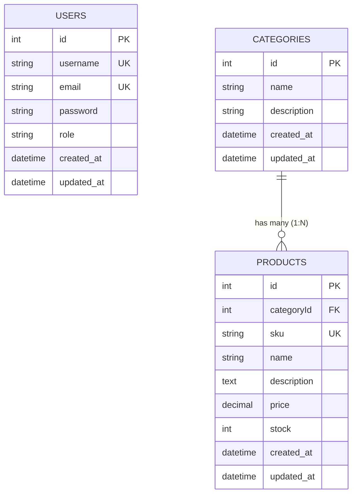

# Technical Test Maganghub Batch 3 - 2026: NestJS Fullstack MVC Admin Panel

Aplikasi web **Admin Panel** berbasis **NestJS (TypeScript)** dengan arsitektur **MVC (Model-View-Controller)** dan Server-Side Rendering (SSR) menggunakan template engine Handlebars (`hbs`) dan database SQLite via TypeORM.

Proyek ini dibuat sebagai pemenuhan seleksi teknis posisi **FullStack Engineer (TypeScript)** untuk program **Maganghub Batch 3 - 2026** di **PT DOT Indonesia**.

---

## 1. Penjelasan Proyek & Fitur

Aplikasi ini mengelola inventaris data dengan relasi **One-to-Many (1:N)** antara tabel **Kategori** (induk) dan tabel **Produk** (anak), dilengkapi dengan sistem otentikasi admin.

### Fitur Utama:
1. **Sistem Otentikasi & Proteksi Sesi**:
   - Halaman **Login** (`/login`) dengan validasi kredensial pengguna.
   - Proteksi route admin menggunakan `AuthGuard` (pengguna tanpa sesi otomatis dialihkan ke `/login`).
   - Fitur **Logout** (`/logout`) yang menghapus sesi aktif.
2. **Manajemen Data Berelasi (One-to-Many / 1:N)**:
   - **Tabel 1 (One) - Kategori**:
     - List Kategori beserta badge jumlah produk terkait.
     - Detail Kategori (`/categories/:id`) menampilkan profil kategori sekaligus **daftar produk yang berafiliasi di bawah kategori tersebut**.
     - Tambah Kategori Baru & Edit Kategori.
     - Hapus Kategori.
   - **Tabel 2 (Many) - Produk**:
     - List Produk dengan relasi kategori induk, format harga Rupiah, dan status ketersediaan stok.
     - Detail Produk (`/products/:id`) menampilkan spesifikasi produk dan link menuju kategori induknya.
     - Tambah & Edit Produk dengan dropdown pilihan kategori.
     - Hapus Produk.
3. **Fitur Pencarian & Filter Canggih (Search & Filter)**:
   - Pencarian Kategori berdasarkan nama atau deskripsi.
   - Pencarian Produk berdasarkan nama, SKU, atau deskripsi, serta filter dropdown berdasarkan kategori tertentu.
4. **Respon Berbentuk Page (MVC) & Dukungan RESTful Murni**:
   - Semua rute browser merender halaman web bersih dan responsif dengan styling basic CSS mandiri (bekerja 100% offline tanpa CDN).
   - Pengujian via Postman (dengan header `Accept: application/json`) mengembalikan respon data JSON murni dengan status kode HTTP yang sesuai (`200 OK`, `201 Created`, dll).
5. **Modern Best Practice (Zero Hidden Fields)**:
   - Operasi update dan delete pada antarmuka web memanggil HTTP method murni (`PUT` dan `DELETE`) via Fetch API tanpa input tersembunyi `_method`.
6. **Error Handling & Validasi Data**:
   - Validasi data input menggunakan `class-validator` & `class-transformer`.
   - Global `HttpExceptionFilter` untuk menangani status 404 (Not Found) dan 500 (Internal Server Error) dengan halaman error yang informatif.

---

## 2. Desain Database (ERD)

Desain basis data terdiri dari 3 entitas utama: `User`, `Category`, dan `Product`.



### Relasi:
- **`Category` 1 &mdash; N `Product`**: Satu kategori dapat menaungi banyak produk. Setiap produk memiliki kunci asing `categoryId` yang merujuk ke tabel `categories`.
- **`User`**: Menyimpan kredensial otentikasi admin dengan kata sandi terenkripsi (*bcrypt*).

---

## 3. Implementasi Pola Arsitektur MVC (Model-View-Controller)

Arsitektur aplikasi ini mematuhi pemisahan tanggung jawab (*Separation of Concerns*):

- **Model**:
  - `src/auth/entities/user.entity.ts`
  - `src/categories/entities/category.entity.ts`
  - `src/products/entities/product.entity.ts`
  - Menggunakan TypeORM dengan driver `better-sqlite3`.
- **View**:
  - Direktori `views/` berisi template Handlebars (`.hbs`).
  - Layout utama: `views/layouts/main.hbs`
  - Partials: `views/partials/sidebar.hbs`, `navbar.hbs`, `alerts.hbs`
  - Modul Views: `views/auth/`, `views/dashboard/`, `views/categories/`, `views/products/`, `views/errors/`
- **Controller**:
  - `src/auth/auth.controller.ts`: Menangani rute `/login` dan `/logout`.
  - `src/dashboard/dashboard.controller.ts`: Menangani `/dashboard` dan statistik ringkasan.
  - `src/categories/categories.controller.ts`: Menangani CRUD `/categories`.
  - `src/products/products.controller.ts`: Menangani CRUD `/products`.
- **Service Layer**:
  - Menangani logika bisnis (*business logic*) dan akses query database: `CategoriesService`, `ProductsService`, `AuthService`, `SeederService`.

---

## 4. Dependensi Proyek

### Dependensi Utama:
- `@nestjs/core` & `@nestjs/common` (v12.4.0) &mdash; Framework backend utama.
- `@nestjs/platform-express` (v12.4.0) &mdash; HTTP adapter server Express.
- `@nestjs/typeorm` & `typeorm` &mdash; Object-Relational Mapper (ORM).
- `better-sqlite3` &mdash; Driver database SQLite lokal (*zero-setup*).
- `hbs` &mdash; Template engine Handlebars untuk MVC view rendering.
- `express-session` &mdash; Manajemen sesi pengguna.
- `bcryptjs` &mdash; Hashing kata sandi satu arah.
- `class-validator` & `class-transformer` &mdash; Validasi dan sanitasi DTO.

---

## 5. Panduan Instalasi & Menjalankan Proyek

### Prasyarat:
- Node.js versi 20+ atau 22+.
- NPM versi 10+.

### Langkah-langkah:

1. **Clone Repository & Masuk ke Folder Proyek**:
   ```bash
   git clone <link-repository-anda>
   cd teknikal-test
   ```

2. **Instal Seluruh Dependensi**:
   ```bash
   npm install
   ```

3. **Jalankan Aplikasi dalam Mode Pengembangan (Development)**:
   ```bash
   npm run start:dev
   ```

4. **Buka Aplikasi di Browser**:
   Akses: [http://localhost:3000](http://localhost:3000)

### Kredensial Default (Auto-Seeder):
Saat aplikasi pertama kali dijalankan, sistem otomatis membuat database `database.sqlite` dan mengisi data awal (*seeding*):
- **Username**: `admin`
- **Password**: `admin123`

---

## 6. Pengujian Endpoint via Postman

Telah disediakan berkas koleksi Postman siap pakai di root proyek: **`postman_collection.json`**.

### Cara Import ke Postman:
1. Buka aplikasi Postman.
2. Klik tombol **Import** di pojok kiri atas.
3. Pilih berkas `postman_collection.json` dari folder proyek ini.
4. Koleksi **Maganghub Technical Test** akan muncul lengkap dengan seluruh request:
   - `POST   /login`
   - `POST   /logout`
   - `GET    /categories` (dengan parameter `search`)
   - `POST   /categories`
   - `GET    /categories/:id`
   - `PUT    /categories/:id`
   - `DELETE /categories/:id`
   - `GET    /products` (dengan parameter `search` & `categoryId`)
   - `POST   /products`
   - `GET    /products/:id`
   - `PUT    /products/:id`
   - `DELETE /products/:id`

> **Tips Pengujian Postman**:
> Postman menyertakan header `Accept: application/json` sehingga respons yang diterima berbentuk JSON murni berstatus `200 OK` atau `201 Created`.

---

## 7. Panduan Rekam Video Demo (Screencast Checklist)

Sesuai instruksi teknis, video demo setidaknya harus mencakup poin-poin berikut:

1. **[ ] Login Flow**:
   - Tunjukkan halaman `/login`. Coba input password salah untuk memperlihatkan pesan error.
   - Masukkan kredensial `admin` / `admin123` dan tunjukkan transisi masuk ke `/dashboard`.
2. **[ ] CRUD 2 Tabel Berelasi**:
   - Tunjukkan daftar kategori & produk.
   - Tambah Kategori baru.
   - Tambah Produk baru yang memilih kategori yang baru saja dibuat.
   - Buka halaman **Detail Kategori** dan perlihatkan produk yang berafiliasi (bukti relasi 1:N).
   - Edit produk/kategori.
   - Hapus produk/kategori.
   - Uji fitur **Pencarian (Search)** nama produk dan filter kategori.
3. **[ ] Testing API di Postman**:
   - Buka Postman dan jalankan endpoint `POST /login`.
   - Jalankan `GET /categories` dan `GET /products`.
   - Jalankan `POST`, `PUT`, dan `DELETE`. Perlihatkan respon JSON berstatus sukses.
4. **[ ] Penjelasan Fitur & Pemilihan Data**:
   - Jelaskan bahwa studi kasus yang dipilih adalah inventarisasi katalog (*Kategori & Produk*) yang merupakan studi kasus universal relasi 1:N.
5. **[ ] Penjelasan Pola MVC dalam Source Code**:
   - Buka VS Code / IDE.
   - Jelaskan letak **Model** (`entities/`), **View** (`views/` dan `.hbs`), serta **Controller** (`*.controller.ts`).
   - Tunjukkan bagaimana Controller berinteraksi dengan Service lalu merender View.
6. **[ ] Penjelasan Error Handling**:
   - Tunjukkan berkas `src/common/filters/http-exception.filter.ts`.
   - Buka URL sembarang di browser (misal `http://localhost:3000/halaman-tidak-ada`) untuk memperlihatkan halaman error 404 kustom.

---

## 8. Catatan untuk Developer Selanjutnya (*Developer Handoff*)

- **Database**: SQLite digunakan untuk kemudahan evaluasi lokal. Jika ingin beralih ke PostgreSQL atau MySQL di production, cukup ubah konfigurasi `TypeOrmModule.forRoot()` di `src/app.module.ts` dengan menyetel driver `postgres`/`mysql` dan konfigurasi environment `.env`.
- **Template Engine**: Template engine menggunakan Handlebars (`hbs`). Seluruh styling mengandalkan utilitas Tailwind CSS via CDN sehingga tidak memerlukan proses build CSS tambahan.
- **Method Override**: Tidak ada field tersembunyi `_method`. Pengiriman method `PUT` dan `DELETE` di sisi client menggunakan standar Fetch API modern.
